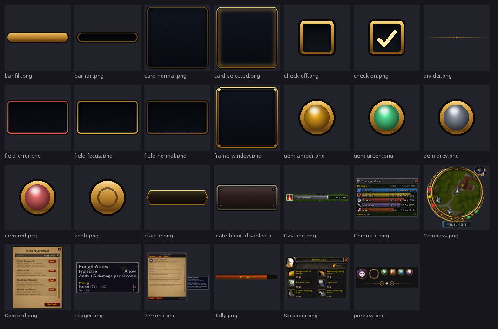

# Open Vanilla Art & Tools

**The art sources, UI kits and generator scripts behind the launcher, website and addon artwork, and the project's maintenance tools.** Most art is generated by scripts, so it can be rebuilt instead of hand-edited.

## What's here

| Folder | What |
|---|---|
| `art/` | Source art: the UI kit (buttons, fields, cards), Persona art, addon screenshots |
| `assets/` | Branding and launcher pieces |
| `tools/gen_*_art.py` | Generators for each addon's and page's artwork |
| `tools/modelport/` | The Model Porter: glTF to 1.12 M2 + BLP (also bundled in [Vanilla Forge](https://github.com/orionopenwow/vanilla-forge)) |
| `tools/png_to_blp*.py`, `tools/mpq_extract.py`, `tools/build_mpq.py` | Texture and archive helpers |
| `tools/workshop_*.py` | The Workshop index |
| `tools/autopilot/`, `tools/botlab/` | Herald's planner, simulator and bot lab |
| `orion/` | Proof-of-uptime receipts for the Orion network: peers that relay or seed sign receipts for the host that helped them |

Most tools are standard-library Python 3.10+; the art generators use Pillow.

## Part of Open Vanilla

[Open Vanilla](https://github.com/orionopenwow/OpenVanilla) is a free, open-source, community-built Vanilla project ([openvanilla.app](https://openvanilla.app/), [Discord](https://discord.gg/r6nj5p8U4)). Its products:

- [Vanilla Forge](https://github.com/orionopenwow/vanilla-forge): The Open Vanilla creator app: maps, models, creatures, quests, items and addons, tested in a copy of your game and published as a signed pack.
- [Vanilla Agents](https://github.com/orionopenwow/vanilla-agents): Your AI coding helpers as heroes in a cosy inn: you roam, they work, a checker verifies every quest.
- [Herald](https://github.com/orionopenwow/herald): The Open Vanilla Discord bot, the in-game World chat bridge, and Herald Autopilot: he plays a character for you, simulates gear and learns from play.
- [Open Vanilla Server](https://github.com/orionopenwow/openvanilla-server): Everything that runs a realm: the realm images and CMaNGOS patches, the web/asset service, Server Studio, Play Solo packs, the relay, and the turnkey Hetzner deployment.
- [Open Vanilla Launcher](https://github.com/orionopenwow/openvanilla-launcher): OpenVanilla.exe: play online, solo or in the browser, the Workshop, signed updates and live news; plus the release packaging.
- [Vanilla Remastered UI](https://github.com/orionopenwow/vanilla-remastered-ui): The in-game addon suite (WenillaCore, Quests, Transmog, Achievements, Guilds and the rest), Classic+ data, and the Workshop addon catalog.
- [openvanilla.app](https://github.com/orionopenwow/openvanilla-site): The Open Vanilla website (GitHub Pages) and the player manual.
- [Open Vanilla Devkit](https://github.com/orionopenwow/openvanilla-devkit): Test a change in seconds on your PC, try it against the live realm, and let a staging realm prove it first; plus the project's checks and tests.
- [Open Vanilla Agent Kit](https://github.com/orionopenwow/openvanilla-agent-kit): Let an AI coding agent change your copy of Open Vanilla for you: addons, interface, your own realm's rates and NPCs.
- [Open Vanilla Art & Tools](https://github.com/orionopenwow/openvanilla-art-tools) (this one): Art sources, UI kits and the generator scripts behind the launcher, site and addon artwork; plus the project's maintenance tools.

## License

MIT: see [LICENSE](LICENSE). Fonts keep their own licenses (SIL OFL), as noted next to them.

## About this repository

This repository is published from **Open Vanilla** (commit `61043afb18`: a). Changes are made there and arrive here with each release, so please open issues and pull requests on [Open Vanilla](https://github.com/orionopenwow/OpenVanilla/issues).

World of Warcraft is a trademark of Blizzard Entertainment, Inc. Open Vanilla is an independent fan project, not affiliated with or endorsed by Blizzard Entertainment. No Blizzard game files are included: you need your own.
